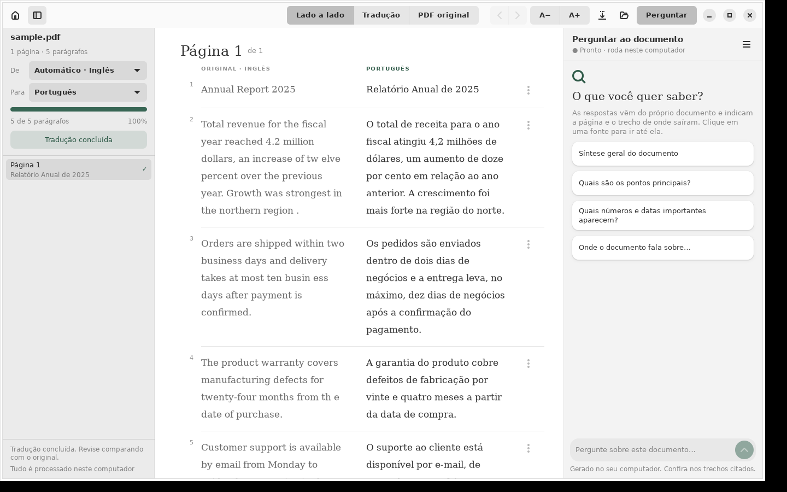
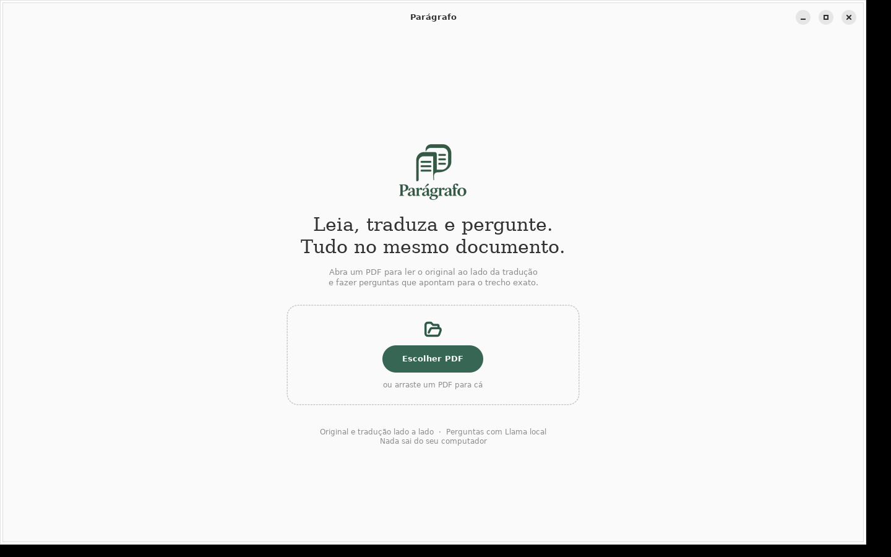
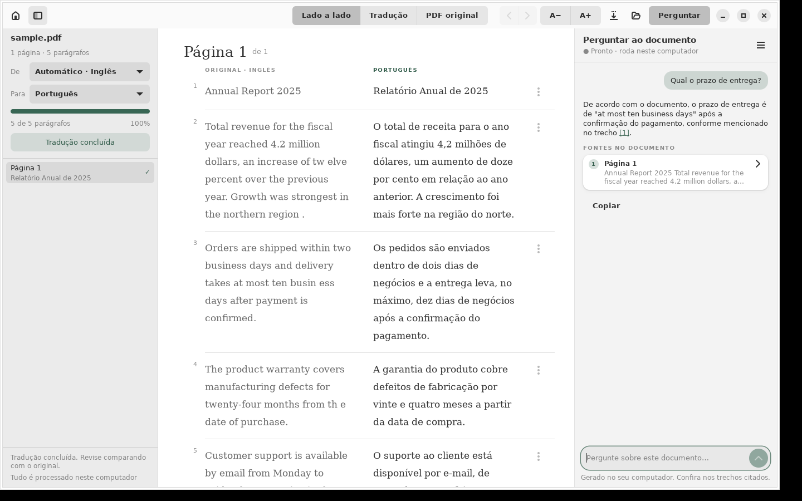
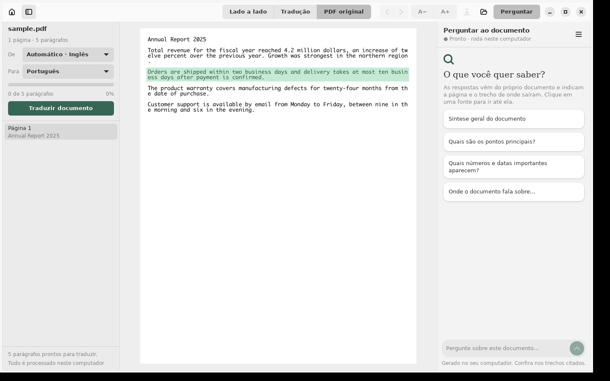

# Parágrafo para Linux

App nativo para Linux (Rust, GTK 4 e libadwaita): leia um PDF com a tradução ao lado do original e faça perguntas ao documento. Tudo roda no seu computador.

É o porte do [Parágrafo para macOS](https://github.com/Magnumja/Paragrafo). A lógica (parágrafos, trabalho salvo, busca, prompts) foi portada linha a linha, junto com as verificações; a interface foi refeita com os componentes do GNOME.



| Tela inicial | Pergunta com fonte | PDF original com o trecho marcado |
|---|---|---|
|  |  |  |

## Instalar

Um comando instala tudo: as bibliotecas do sistema, o Rust (se faltar), o app com atalho no menu, e o Ollama com os modelos que traduzem e respondem.

```sh
./scripts/install.sh
```

No Linux não há um tradutor do sistema como o do macOS: quem traduz é um modelo que roda no seu computador pelo [Ollama](https://ollama.com). Por isso o instalador baixa o Ollama e dois modelos, uma única vez (cerca de 3 GB no total): `llama3.2:3b`, que traduz e responde, e `bge-m3`, que encontra os trechos do documento.

Pedem `sudo` só os pacotes do sistema e o Ollama; o app vai para a sua pasta pessoal (`~/.local/bin/paragrafo`, atalho e ícone em `~/.local/share`). Depois disso o Parágrafo aparece no menu de aplicativos e no "Abrir com" de arquivos PDF.

Só o app, sem o Ollama (abrir, ler e exportar funcionam; traduzir e perguntar, não):

```sh
./scripts/install.sh --sem-ollama
```

Se o Ollama ou o modelo faltarem, o app mostra o que fazer logo abaixo do botão Traduzir, e oferece o download do modelo quando o Ollama já está instalado.

Funciona em distribuições com `apt`, `dnf`, `pacman` ou `zypper` que tragam GTK 4.12+ e libadwaita 1.5+ (Ubuntu 24.04, Fedora 40, Debian 13 ou mais novos). Testado no Ubuntu 24.04; os nomes de pacote das outras distribuições não foram testados.

Opcional, para traduções melhores (modelo feito para traduzir; é usado sozinho quando está instalado):

```sh
ollama pull translategemma:4b
```

## O que o app faz

**Ler e traduzir**

- Abra um PDF com Ctrl+O, arrastando para a janela, pelo "Abrir com" do gerenciador de arquivos, pela linha de comando (`paragrafo arquivo.pdf`) ou pela lista de recentes.
- Três modos de leitura: **Lado a lado**, **Tradução** e **PDF original**.
- A tradução começa pela página que você está lendo. Pause e continue quando quiser.
- O trabalho fica salvo por arquivo: ao reabrir o mesmo PDF, a tradução, o índice de busca e a síntese voltam na hora.
- Páginas na barra lateral, com o progresso de cada uma. ← → e Page Up / Page Down mudam de página, Home / End vão à primeira e à última, e deslizar dois dedos na horizontal também vira a página. Ctrl+[ e Ctrl+] continuam valendo.
- Tamanho do texto com Ctrl++, Ctrl+− e Ctrl+0.
- Exporte como PDF traduzido, Markdown bilíngue ou texto bilíngue.

**Perguntar ao documento** (Ctrl+K)

- Pergunte em português sobre um documento em qualquer idioma. A resposta é escrita por um modelo Llama local a partir de trechos recuperados do próprio PDF.
- Cada afirmação traz uma citação. Clique na citação ou no cartão da fonte para ir à página e ver o trecho marcado; no modo PDF original, a marcação aparece sobre a página real.
- **Síntese geral** resume o documento inteiro. Documentos longos são lidos em partes.
- Em cada parágrafo: copiar, pedir uma explicação daquele trecho ou espiar o trecho no PDF original sem sair da leitura.
- O modelo de conversa pode ser trocado no menu do painel.

## Diferenças em relação ao app do Mac

| | macOS | Linux |
|---|---|---|
| Interface | SwiftUI | GTK 4 + libadwaita |
| Tradução | framework Translation da Apple | modelo local no Ollama (`translategemma`, ou o modelo de conversa) |
| Texto do PDF | PDFKit | Poppler |
| OCR | Vision | Tesseract (opcional; sem ele, páginas digitalizadas ficam sem texto e o app avisa) |
| Idioma do documento | NaturalLanguage | `whatlang` + `whichlang` |
| Trabalho salvo | `~/Library/Application Support/Paragrafo` | `~/.local/share/paragrafo` (mesmo formato de arquivo) |

O modo PDF original mostra uma página por vez, e a leitura lado a lado não muda para colunas empilhadas em janelas estreitas.

Como a tradução é feita por um modelo de linguagem, ela é mais lenta que a do macOS e depende do modelo e do computador: com placa de vídeo, cerca de um segundo por parágrafo; só com o processador, de 10 a 30 segundos. A barra lateral mostra o tempo restante estimado. Compare termos, números e referências com o original.

## Privacidade

Nada é enviado para fora do computador. O único endereço de rede que o app aceita é o Ollama local (`http://127.0.0.1:11434`): outros servidores, modelos "cloud", proxies e redirecionamentos são recusados no código, e o cliente HTTP é compilado sem TLS. Os arquivos salvos ficam legíveis só pelo seu usuário.

## Verificação

```sh
./scripts/check.sh
```

Roda o linter sem avisos e todos os testes: agrupamento de linhas, estado do documento, idiomas, trabalho salvo (incluindo travessia de pasta e symlinks), links das respostas, divisão em trechos, busca híbrida, política de rede, extração de PDF real, OCR real e PDF exportado. As partes ao vivo usam o Ollama real quando ele está em execução e são puladas quando não está; o mesmo vale para o Tesseract.

Para compilar e verificar a partir de outro sistema, `scripts/dev.sh` roda qualquer comando num contêiner Ubuntu 24.04 (requer Docker):

```sh
scripts/dev.sh scripts/check.sh
```

## Código

| Caminho | Papel |
|---|---|
| `core/` | Lógica sem interface, testável em qualquer lugar |
| `core/src/extraction.rs` | Linhas → parágrafos |
| `core/src/document.rs` | Parágrafos, páginas e progresso |
| `core/src/library.rs` | Trabalho salvo por arquivo e recentes |
| `core/src/rag.rs` | Divisão em trechos, índice vetorial, busca híbrida, prompt |
| `core/src/ollama.rs` | Cliente HTTP do Ollama (somente local) |
| `core/src/assistant.rs` | Disponibilidade, índice, perguntas e síntese |
| `core/src/translate.rs` | Tradução parágrafo a parágrafo |
| `core/src/answer.rs` | Citações e páginas viram links |
| `app/src/main.rs` | Janela, barra de ferramentas, leitura |
| `app/src/chat.rs` | Painel de perguntas |
| `app/src/pdf.rs` | Poppler, Tesseract, visualização e PDF exportado |

Variáveis de ambiente úteis: `PARAGRAFO_TRANSLATION_MODEL` (modelo de tradução), `PARAGRAFO_OCR_LANGS` (idiomas do Tesseract, por exemplo `por+eng`), `PARAGRAFO_LIBRARY` (pasta do trabalho salvo).

## Limites

- **Respostas:** o modelo padrão tem 3 bilhões de parâmetros. Responde bem a perguntas factuais, mas pode resumir de forma imprecisa ou citar o trecho errado. Confira sempre na fonte indicada.
- **Extração:** parágrafos são separados por distância, recuo, tamanho de fonte e ordem das linhas. Colunas, tabelas e escrita vertical podem exigir revisão. Palavras hifenizadas no fim da linha são reunidas.
- **PDFs protegidos** precisam ser desbloqueados antes. A conversa com o assistente vale para a sessão; só a síntese fica salva.
- **Testado** em Ubuntu 24.04 (contêiner e CI), com a interface exercitada num display virtual. Ainda não foi usado no dia a dia numa área de trabalho GNOME real.

Licença MIT.
